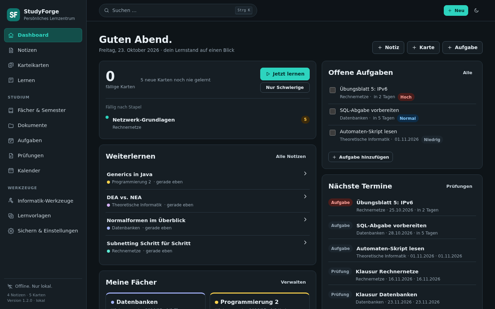
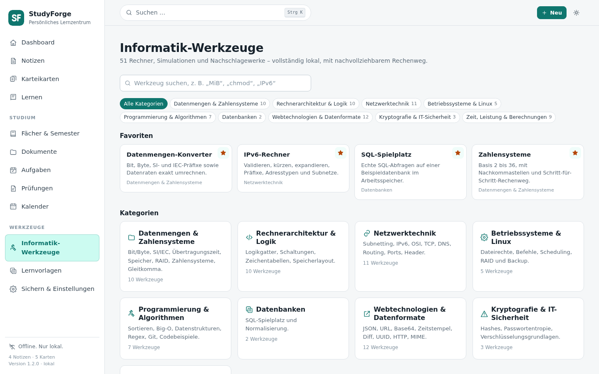
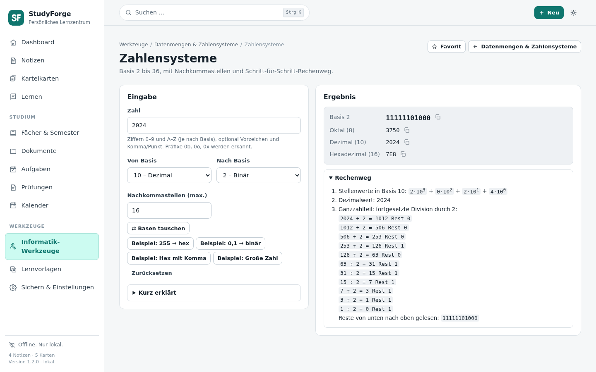

# StudyForge

**Version 1.2.0** – Änderungen siehe [CHANGELOG.md](CHANGELOG.md).

Ein persönliches, vollständig lokales Lernzentrum für das Informatikstudium:
Notizen, Karteikarten mit verteilter Wiederholung, Dokumente, Aufgaben,
Prüfungen und Lernwerkzeuge – ohne Konto, ohne Cloud, ohne Telemetrie.



## Schnellstart

1. Repository herunterladen: **Code → Download ZIP** und entpacken – oder
   `git clone` und in den Ordner wechseln.
2. Einrichten (prüft Node.js und lädt bei Bedarf eine portable Version, ohne
   Administratorrechte):
   - **Windows:** `setup.cmd` doppelklicken
   - **Linux/macOS:** `sh setup.sh`
3. Starten: `start.cmd` bzw. `./start.sh` – die Oberfläche öffnet sich unter
   <http://localhost:4173>.

Ausführliche Anleitung für Einsteiger: **[ANLEITUNG.md](ANLEITUNG.md)**.

| Informatik-Werkzeuge | Zahlensysteme mit Rechenweg |
| --- | --- |
|  |  |

## Funktionen

| Bereich | Inhalt |
| --- | --- |
| **Dashboard** | Weiterlernen, offene Aufgaben, fällige Karten, nächste Termine, Lernfortschritt je Fach, verstandene und offene Themen, Schnellzugriffe |
| **Notizen** | Markdown mit Vorschau, Formeln (KaTeX), Codeblöcke, Tabellen, Ordnerhierarchie, Schlagwörter, Favoriten, Anheften, `[[Verknüpfungen]]`, Anhänge, Versionen, Papierkorb |
| **Suche** | Eine Suche über Titel, Inhalt, Schlagwörter, Fach, Dateinamen, PDF-Text und Aufgabentexte – umlautunabhängig (`Grusse` findet `Grüße`) |
| **Karteikarten** | Frage/Antwort, Definition, Lückentext, Richtig/Falsch, Multiple Choice, Code – manuell oder aus einer Notiz |
| **Lernen** | Ruhiger Lernmodus nach Fach, Stapel, Thema, schwierigen Inhalten, offenen Lernzielen oder gemischt; Antwort erst auf Wunsch; optionale Zeitbegrenzung; Abschlussübersicht mit nächstem Schritt |
| **FSRS** | Lokal implementierte Wiederholungsplanung (FSRS-5) mit ehrlicher Intervallvorschau für alle vier Bewertungen |
| **Dokumente** | PDF, Text, Markdown, Code, Bilder; Zuordnung zu Fach/Thema/Notiz; PDF-Anzeige im Browser; **lokale PDF-Volltextsuche** mit Textauszug im Viewer; Download; Originaldateien bleiben unverändert |
| **Aufgaben & Prüfungen** | Priorität, Fälligkeit, Status, Unteraufgaben, Verknüpfungen; Prüfungsstoff, Lernziele, offene Themen, Selbsteinschätzung, Uhrzeit und Ort – ohne erfundene Prognosen |
| **Kalender** | Import von `.ics`-Dateien mit Vorschau, Monats-/Wochen-/Listenansicht, Prüfungen und Abgaben farblich hervorgehoben, Verknüpfung von Terminen mit Prüfungen |
| **Informatik-Werkzeuge** | 51 Rechner, Simulationen und Nachschlagewerke in 9 Kategorien (Datenmengen & Zahlensysteme, Architektur & Logik, Netzwerk, Betriebssysteme, Algorithmen, Datenbanken inkl. SQL-Spielplatz, Web, Sicherheit, technische Berechnungen) – mit Rechenweg, Suche und Favoriten; darunter weiterhin IPv4-Subnetting-Übung, Codebeispiele und Formelsammlung. Übersicht: [docs/WERKZEUGE.md](docs/WERKZEUGE.md) |
| **Vorlagen** | Neun anpassbare Lernvorlagen (Kapitel, Definition, Lösungsweg, Dokumentation, Fehleranalyse, Vergleich, Prüfung, Netzwerk, Code) |
| **Sichern** | Vollständiges ZIP-Backup inklusive Anhängen, JSON-Export, Markdown-Export, Kartenexport, geprüfte Wiederherstellung |

## Voraussetzungen

- **Node.js 22.5 oder neuer** (getestet mit Node 24.22.0 unter Windows und
  Node 22.23.3 unter Linux Mint).
  StudyForge nutzt das eingebaute Modul `node:sqlite`; es gibt **keine npm-Abhängigkeiten** und keinen Build-Schritt.
  Fremdcode liegt fest im Projekt: KaTeX (`public/vendor/katex/`) und
  ical.js 2.2.1 für den Kalenderimport (`server/vendor/ical/`, MPL-2.0).
- Ein aktueller Browser (Chrome, Edge, Firefox, Chromium).
- Keine Administratorrechte und keine Installation. Internet nur, falls das
  Setup Node.js herunterladen soll – StudyForge selbst läuft offline.

Node.js ist als LTS-Version kostenlos unter <https://nodejs.org/> erhältlich.
Für einen USB-Stick genügt eine portable Node-Version (ZIP-Archiv); sie muss
nicht systemweit installiert werden.

## Einrichten

Für die Ersteinrichtung gibt es ein Setup, das Node.js prüft und bei Bedarf
(nach Rückfrage, ohne Administratorrechte) eine portable Version nach
`runtime/node` lädt, die Prüfsumme kontrolliert, optional eine
Desktop-Verknüpfung bzw. einen Menüeintrag anlegt und alles prüft:

- **Windows:** `setup.cmd` doppelklicken
- **Linux/macOS:** `sh setup.sh`

Schritt-für-Schritt-Anleitung für neue Nutzer (inkl. Weitergeben, Update,
USB-Stick, Problemlösung): **[ANLEITUNG.md](ANLEITUNG.md)**.
`start.*` und `stop.*` verwenden `runtime/node` automatisch, wenn vorhanden.

## Starten

### Linux Mint / Debian

```bash
cd StudyForge
./start.sh
```

Falls das Skript nicht ausführbar ist: `sh start.sh`.
`start.sh` verwendet automatisch eine portable Node-Version unter
`~/.local/share/node/current/`, falls vorhanden – praktisch, wenn die
Distribution nur ein veraltetes Node (z. B. 12.x) mitbringt. Ist die gefundene
Version älter als 22.5, bricht das Skript mit einem klaren Hinweis ab.
Node aus einer anderen portablen Installation:

```bash
PATH="/media/usb/node/bin:$PATH" ./start.sh
```

### Windows 10 / 11

`start.cmd` doppelklicken – oder im Terminal:

```bat
cd StudyForge
start.cmd
```

Beide Starthelfer öffnen die Oberfläche unter <http://localhost:4173> und binden
**nur an 127.0.0.1**. Ist der Port belegt, wird automatisch der nächste freie
Port zwischen 4173 und 4192 verwendet. Beenden mit `Strg+C`.

Optionen:

```bash
node scripts/start.js --port 5000 --data-dir /pfad/zu/daten --no-browser
```

### Beenden

- Im Startfenster `Strg+C` drücken – oder
- **Linux:** `./stop.sh` (bzw. `sh stop.sh`), **Windows:** `stop.cmd`
  doppelklicken, plattformunabhängig: `npm run stop`.

Die Stopp-Skripte beenden StudyForge genauso sauber wie `Strg+C`: Der Server
schließt die Datenbank, dann endet der Prozess und der Port wird frei. Dazu legt
der Starthelfer beim Start `data/studyforge.instance.json` an (Prozess-ID, Port
und ein zufälliger Schlüssel, nur für den eigenen Benutzer lesbar); beim
Beenden wird die Datei wieder entfernt. Ohne diesen Schlüssel – etwa von einer
Webseite aus – lässt sich StudyForge nicht beenden. Wurde mit `--data-dir`
gestartet, dieselbe Option auch beim Stoppen angeben:
`./stop.sh --data-dir /pfad/zu/daten`. Läuft nichts, meldet das Skript das
nur. Antwortet der Server nicht mehr, wird der Prozess als letzter Ausweg
direkt beendet; bereits gespeicherte Änderungen bleiben auch dann erhalten.

### USB-Stick

Das Projekt ist vollständig portabel, solange Node.js mitgeführt wird:

```
USB/
├── node/            portable Node-Version (optional)
└── StudyForge/      dieses Projekt inklusive data/
```

`data/` liegt standardmäßig im Projektordner und wandert damit mit. Alternativ
kann der Datenordner über `--data-dir` oder die Umgebungsvariable
`STUDYFORGE_DATA` an einen anderen Ort gelegt werden.

## Wo liegen meine Daten?

Alles liegt im Datenverzeichnis (standardmäßig `StudyForge/data/`):

```
data/
├── studyforge.db     SQLite-Datenbank (Notizen, Karten, Aufgaben, Kalender, Einstellungen …)
├── files/            Kopien aller Anhänge und Dokumente (UUID-Dateinamen)
├── backups/          Sicherheitsbackups vor Wiederherstellungen und Migrationen
└── tmp/              temporäre Dateien
```

- Importierte Originaldateien werden **nur gelesen** und unter einem neutralen
  UUID-Namen kopiert; der Originalpfad wird nicht verändert.
- Die Datenbank nutzt `journal_mode=DELETE`, `synchronous=FULL` und
  Fremdschlüssel – Änderungen sind nach dem Speichern dauerhaft.
- Ein vollständiges Backup muss deshalb **Datenbank + `files/`** enthalten.
  Genau das tut der ZIP-Export; ein reines Kopieren der `.db`-Datei genügt nicht.

## Backup, Export und Wiederherstellung

Unter **Sichern & Einstellungen**:

1. **Vollständiges Backup (ZIP)** – `data.json`, `manifest.json`, alle Dateien
   unter `files/`, Prüfsummen und eine `README.txt`.
2. **Datenexport (JSON)** – strukturierte Daten plus Binärdateien als Base64.
3. **Markdown-Export (ZIP)** – Notizen als `.md` mit YAML-Frontmatter,
   gegliedert nach Fach, inklusive Anhängen und Dokumenten.
4. **Kartenexport (JSON)** – dokumentiertes Format, siehe
   [docs/DATENFORMATE.md](docs/DATENFORMATE.md).
5. **Wiederherstellen** – die Datei wird zuerst geprüft (Format, Tabellen,
   Prüfsummen). Erst nach ausdrücklicher Bestätigung werden die vorhandenen
   Daten ersetzt; vorher entsteht automatisch ein Sicherheitsbackup in
   `data/backups/`. Beschädigte oder unvollständige Dateien werden mit einer
   verständlichen Meldung abgelehnt, ohne Daten zu löschen.
6. **Zurücksetzen** (Einstellungen → „Zurücksetzen“):
   - *Einstellungen zurücksetzen* stellt Design, Schriftgröße und
     Lerneinstellungen auf die Standardwerte; Inhalte bleiben unverändert.
   - *Alles zurücksetzen* löscht alle Inhalte und Anhänge, danach ist
     StudyForge wie neu installiert (mitgelieferte Vorlagen und
     Standardeinstellungen werden neu angelegt). Dazu muss `ZURÜCKSETZEN`
     eingegeben werden. Vorher wird
     `data/backups/auto-vor-zuruecksetzen-<Zeitstempel>.zip` geschrieben, das sich
     normal wiederherstellen lässt. Kann diese Sicherung nicht vollständig
     erstellt werden (z. B. fehlende Anhangsdatei), wird nichts gelöscht.

Kalenderquellen, Termine und Prüfungsverknüpfungen sind Teil des ZIP- und
JSON-Backups. Backups aus Version 1.0.0 lassen sich weiterhin einlesen; der
Kalender ist danach leer (die Prüfung weist darauf hin).

### Update von 1.0.0 auf 1.1.0

Beim ersten Start von 1.1.0 wird die Datenbank automatisch von Schema 2 auf
Schema 3 erweitert (neue Kalendertabellen, Uhrzeit/Ort/Kalenderverknüpfung bei
Prüfungen). Die Migration fügt nur hinzu und löscht nichts. Vorher legt
StudyForge `data/backups/vor-migration-schema2-zu-3-<Zeitstempel>.db` an und
prüft diese Kopie auf Integrität und vollständige Datensatzzahlen – nur dann
wird migriert. Zurück auf den alten Stand: StudyForge beenden, die Sicherung
als `data/studyforge.db` einsetzen, Version 1.0.0 starten. Unter
**Sichern & Einstellungen → Speicherort** stehen Version, Schema und die
letzte Migration.

Einzelne Notizen lassen sich zusätzlich als Markdown herunterladen. Ein
PDF-Export ist über die Druckfunktion des Browsers möglich (die Druckansicht
blendet Navigation und Bedienelemente aus).

## Kalender und ICS-Import

### Importieren

1. Im Kalenderprogramm bzw. Hochschulportal den Kalender als **`.ics`-Datei**
   exportieren (Outlook: „Kalender speichern“, Google Kalender: Einstellungen →
   Export, Thunderbird: Kalender → Exportieren).
2. In StudyForge **Kalender** öffnen und die Datei auf die Seite ziehen oder
   **ICS importieren** wählen (mehrere Dateien möglich; auch über
   „Neu → Kalender importieren“).
3. Die **Vorschau** zeigt jeden erkannten Termin mit Zeit, Ort, Art,
   Wiederholung und Status, außerdem Lesefehler und Hinweise. Serien
   erscheinen als ein Eintrag mit Anzahl der Vorkommen.
4. **Importieren** speichert, **Abbrechen** verwirft alles. Bei mehreren
   Dateien lässt sich jede einzeln überspringen.

Alles geschieht lokal: Die Datei wird an den eigenen StudyForge-Prozess
(127.0.0.1) übergeben, gelesen und in `data/studyforge.db` gespeichert. Es gibt
keine Kalenderabos, keine Synchronisation und keine externen Dienste; die
Originaldatei wird nie verändert. Erinnerungen (`VALARM`) werden angezeigt,
StudyForge sendet aber keine Benachrichtigungen.

Beschädigte Dateien bringen die Anwendung nicht zum Absturz: Ist eine Datei
nur stellenweise fehlerhaft, werden die vollständig lesbaren Termine einzeln
übernommen und die fehlerhaften Stellen in der Vorschau benannt. Dateien ohne
lesbare Termine werden mit einer Meldung abgelehnt, ohne etwas zu speichern.

### Erneuter Import (Aktualisieren)

Jede importierte Datei ist eine **Kalenderquelle**. Wird dieselbe Datei
(gleicher Dateiname oder Kalendername oder überwiegend bekannte Termine)
erneut importiert, schlägt die Vorschau vor, diese Quelle zu aktualisieren:

- Termine werden über `UID` (+ `RECURRENCE-ID` bei Serien) wiedererkannt.
  Unveränderte bleiben unangetastet, geänderte werden aktualisiert – mit
  derselben internen ID, deshalb bleiben **Verknüpfungen mit Prüfungen
  erhalten**.
- Ist die Datei älter als der Bestand (`SEQUENCE`/`LAST-MODIFIED`), wird der
  neuere Stand nicht überschrieben.
- Termine, die in der Datei fehlen, werden entfernt – **außer** eine Prüfung
  verweist darauf: dann bleibt der Termin erhalten und wird als „in der Quelle
  nicht mehr enthalten“ markiert. **Prüfungen werden nie automatisch gelöscht
  oder geändert.**
- Dieselben Termine in einer zweiten Quelle werden als Duplikat übersprungen.
- Die eigene Terminart (z. B. „Prüfung“) bleibt erhalten.

**Quelle entfernen** löscht nur die importierten Termine dieser Quelle;
verknüpfte Prüfungen bleiben vollständig erhalten (nur die Verknüpfung
entfällt). **Prüfung löschen** lässt den Kalendertermin bestehen.

### Termine mit Prüfungen verknüpfen

- **Termin → Prüfung:** Termin anklicken → „Mit vorhandener Prüfung
  verknüpfen“ oder **„Neue Prüfung aus Termin“**. Titel, Datum, Uhrzeit, Ort und
  Beschreibung werden vorgeschlagen und können vor dem Speichern geändert
  werden; die neue Prüfung ist automatisch verknüpft.
- **Prüfung → Termin:** In der Prüfungsansicht „Mit Kalendertermin verknüpfen“.
- Eine Prüfung hat höchstens einen Kalendertermin, ein Termin gehört
  höchstens zu einer Prüfung. Ändern oder Aufheben ist jederzeit möglich, ohne
  Termin oder Prüfung zu löschen.
- Die Prüfungskarte zeigt den verknüpften Termin mit Datum, Uhrzeit, Ort,
  Beschreibung und „Im Kalender öffnen“. Weichen Datum, Uhrzeit oder Ort nach
  einem erneuten Import ab, erscheint ein Hinweis mit „… aus Kalender
  übernehmen“ – übernommen wird nur auf Klick.
- **Vorschläge:** Über den Prüfungen stehen mögliche Paare (gleiches Datum und
  gemeinsamer Titelbegriff oder als Prüfung erkannter Termin). Sie sind als
  *unverbindlich* gekennzeichnet; verknüpft wird nur nach Bestätigung.

## Datenschutz und Offline-Betrieb

- Keine externen CDNs, Schriftarten, Bilder, Skripte oder Analyse-Dienste.
  KaTeX und alle Schriften liegen unter `public/vendor/`.
- Der Server bindet ausschließlich an Loopback und weist fremde `Host`-Header
  ab (DNS-Rebinding-Schutz).
- Schreibende API-Aufrufe mit fremdem `Origin` werden mit `403` abgelehnt.
- Strikte Content-Security-Policy: `default-src 'self'`, `object-src 'none'`,
  `connect-src 'self'`.
- Markdown wird vollständig escaped; rohes HTML und Skripte aus Notizen werden
  nie ausgeführt. Externe Bilder werden nicht automatisch geladen.
- Importierte Dateien werden nicht ausgeführt, nur gespeichert und angezeigt.
- Dateinamen werden entschärft; Pfadmanipulation (`../`) und Zugriffe außerhalb
  von `public/` bzw. `data/files/` sind gesperrt.
- Keine Benutzerkonten, keine Synchronisierung, keine Telemetrie.

Prüfen lässt sich das mit:

```bash
npm run check:offline
```

Das Skript durchsucht alle HTML-, CSS-, JS- und SVG-Dateien der Oberfläche nach
externen Verweisen und prüft, ob KaTeX lokal vorliegt.

## Architektur

Bewusst einfach und wartbar:

```
Browser (Vanilla JS, ES-Module, kein Build)
        │  fetch / JSON
        ▼
Node.js HTTP-Server (server/server.js)
        │
        ├── Router + Validierung (http-util.js, util.js, api-shared.js)
        ├── SQLite über node:sqlite (db.js)
        ├── FSRS-5 (fsrs.js)
        ├── ZIP schreiben/lesen (zip.js)
        └── Backup/Restore (backup.js)
```

- **Keine Laufzeit-Abhängigkeiten**: `package.json` enthält weder
  `dependencies` noch `devDependencies`. Aktualisierungen von Fremdpaketen
  entfallen; die Angriffsfläche bleibt klein.
- **Ein Prozess, eine Datenbank, ein Port.** Kein Bundler, kein Transpiler.
- **Frontend als SPA** mit Hash-Routing (`#/notizen`, `#/lernen`, …), damit
  auch ein einfacher Dateiserver funktionieren würde.
- **Serverseitige Validierung** aller Eingaben, Grenzen für Textlängen und
  Uploads (64 MB pro Datei, 256 MB pro Import).
- **API** unter `/api/…`; die Oberfläche nutzt ausschließlich diese Endpunkte.

### Projektstruktur

```
StudyForge/
├── start.sh / start.cmd        Starthelfer
├── stop.sh / stop.cmd          sauber beenden
├── setup.sh / setup.cmd        Einrichtung (Node prüfen/laden, Verknüpfung, Prüfung)
├── ANLEITUNG.md                Anleitung für neue Nutzer
├── runtime/node/               portable Node-Version (vom Setup, optional)
├── scripts/start.js            Startlogik (Port, Browser, Datenordner)
├── scripts/stop.js             Stopplogik (Instanzdatei, Schlüssel, Prozess)
├── scripts/setup-check.js      Prüfung der Einrichtung
├── scripts/setup-windows.ps1   Setup-Logik für Windows (von setup.cmd aufgerufen)
├── scripts/check-offline.js    Prüfung auf externe Ressourcen
├── server/
│   ├── server.js               HTTP-Server, statische Dateien, Sicherheitsheader
│   ├── instance.js             Instanzdatei und Schlüssel für stop.sh/stop.cmd
│   ├── db.js                   Schema, Indizes, Standardwerte, Vorlagen
│   ├── api.js                  Meta, Semester, Fächer, Ordner, Notizen, Suche, Dashboard
│   ├── api-learn.js            Stapel, Karten, Lernmodus, Bewertungen
│   ├── api-organize.js         Aufgaben, Prüfungen, Themen, Ziele, Werkzeuge, Vorlagen
│   ├── api-files.js            Dokumente und Anhänge
│   ├── file-text.js            Textindizierung (PDF/Text) und Nachindizierung
│   ├── pdf-text.js             PDF-Textextraktion ohne Fremdbibliothek
│   ├── api-transfer.js         Export, Import, Backups
│   ├── api-tools.js            SQL-Spielplatz (Endpunkt)
│   ├── sql-sandbox*.js         SQL-Spielplatz: Prüfung und Ausführung im Kindprozess
│   ├── api-calendar.js         Kalenderquellen, Termine, Import, Prüfungsverknüpfung
│   ├── ics.js                  ICS-Verarbeitung (Zeitzonen, Serien, Fehlertoleranz)
│   ├── vendor/ical/            ical.js 2.2.1 (MPL-2.0), mitgeliefert
│   ├── backup.js               ZIP/JSON-Sicherung und Wiederherstellung
│   ├── fsrs.js                 Wiederholungsalgorithmus
│   ├── zip.js                  ZIP-Implementierung (Store/Deflate, CRC32)
│   └── util.js / api-shared.js / http-util.js / config.js
├── public/
│   ├── index.html
│   ├── favicon.svg / favicon.ico   App-Icon (auch Logo in der Navigation)
│   ├── icons/                  PNG-Favicons 16/32 px, Apple-Touch-Icon 180 px
│   ├── css/app.css             Designsystem, hell/dunkel, Druckansicht
│   ├── css/tools.css, css/tools/   Gestaltung der Informatik-Werkzeuge
│   ├── js/app.js               Routing, Suche, Tastatur
│   ├── js/views/…              je Bereich eine Ansicht
│   ├── js/tools/               Informatik-Werkzeuge: registry.js, kit.js,
│   │                           core/ (Rechenlogik, getestet), ui/ (Oberflächen)
│   ├── js/lib/markdown.js      sicherer Markdown-Renderer
│   ├── js/lib/highlight.js     Syntaxhervorhebung
│   └── vendor/katex/           lokal mitgeliefertes KaTeX inkl. Schriften
├── test/                       automatisierte Tests (node:test)
│   └── fixtures/               echte 1.0.0-Datenbank und -Backup für Migrationstests
├── docs/                       Datenformate, Werkzeugübersicht, Screenshots
├── .github/workflows/test.yml  Tests bei jedem Push (GitHub Actions)
└── LICENSE                     MIT-Lizenz
```

### Datenmodell (SQLite)

`semesters`, `subjects`, `folders`, `notes`, `tags`, `note_tags`, `note_links`,
`note_versions`, `files`, `decks`, `cards`, `reviews`, `tasks`, `subtasks`,
`task_notes`, `task_files`, `exams`, `topics`, `goals`, `snippets`, `formulas`,
`subnet_exercises`, `templates`, `settings`, `meta`, seit 1.1.0 zusätzlich
`calendar_sources` und `calendar_events` (Details in
[docs/DATENFORMATE.md](docs/DATENFORMATE.md)). Prüfungen verweisen über
`exams.calendar_event_id` auf ihren Termin; Termine speichern ganztägige Daten
als Datum und alle anderen Zeiten in UTC.

Alle Tabellen nutzen Fremdschlüssel mit sinnvollem `ON DELETE`-Verhalten:
Notizen bleiben beim Löschen eines Fachs erhalten (nur die Zuordnung entfällt),
Karten bleiben beim Löschen eines Stapels erhalten, Unterordner werden
mitgelöscht, Anhänge werden beim endgültigen Löschen einer Notiz entfernt.

### Lernalgorithmus

`server/fsrs.js` implementiert FSRS-5 transparent und ohne Fremdbibliothek:
Stabilität, Schwierigkeit, Abrufwahrscheinlichkeit und Intervallberechnung.
Bewertungen: **1 Nicht gewusst**, **2 Schwierig**, **3 Gut**, **4 Sicher**.
„Nicht gewusst“ plant eine kurze Wiederholung (10 Minuten), gute Bewertungen
wachsen mit jedem erfolgreichen Abruf. Die Ziel-Merkfähigkeit (70–99 %) ist
einstellbar; höhere Werte ergeben kürzere Abstände. Die Oberfläche zeigt vor
der Bewertung die konkret geplanten Intervalle an – keine versteckten Regeln.

## Tests

```bash
npm test
```

Die Tests starten echte Serverinstanzen in temporären Datenverzeichnissen und
prüfen über HTTP:

- **FSRS**: neue Karten, Intervallwachstum, Vergessen, Vorschau, Grenzen.
- **Notizen**: Umlaute und Sonderzeichen, leere Eingaben, Suche über Inhalt,
  Schlagwörter, Fach und Anhänge, Verlinkungen, Versionen, Papierkorb,
  Ordnerhierarchie, 300 Notizen mit Seitenteilung.
- **Karten**: alle sechs Typen, Validierungsfehler, Lernmodus nach Fach, Stapel,
  Thema und Schwierigkeit, Bewertung, Historie, Zurücksetzen, Aussetzen.
- **Dateien**: Upload, Anzeige, Download, entschärfte Dateinamen, fehlende
  Dateien, Löschen, PDF-Volltext (Extraktion, Suche, Textauszug, Neuindizierung).
- **Studienorganisation**: Aufgaben mit Unteraufgaben und Verknüpfungen,
  Prüfungen mit Datum und Selbsteinschätzung, Themen/Lernziele, Fortschritt,
  Subnetting-Rechner und Übungsprüfung, Vorlagen.
- **Sicherheit**: fremder `Origin`, fremder `Host`, Pfad-Ausbruch, CSP-Header.
- **Transfer**: vollständiges Backup inklusive Anhängen, Wiederherstellung,
  JSON-Export/-Import, Kartenformat, Markdown-Export, beschädigte Dateien,
  Bestätigungspflicht, Persistenz nach Neustart.
- **Kalender** (`test/calendar.test.js`): mehrere Termine, Umlaute und
  Escapes, Windows-1252, ganztägige und mehrtägige Termine, Zeitzonen
  (VTIMEZONE, UTC, IANA ohne VTIMEZONE, Windows-Namen, Sommerzeitwechsel),
  Serien mit EXDATE und geänderten Einzelterminen, beschädigte/zu große
  Dateien, Duplikate, Verknüpfen/Aufheben/Ersetzen, Prüfung aus Termin,
  erneuter Import mit Änderungen und Löschungen, Erhalt von Prüfungen, Notizen
  und Lernständen, Backup/Restore inkl. Kalender, Restore eines 1.0.0-Backups,
  Migration einer echten 1.0.0-Datenbank, Favicon-/Icon-Verweise, Offline.
- **Informatik-Werkzeuge** (`test/tools-*.test.js`): SI/IEC und Datenraten,
  große Ganzzahlen, Zahlensysteme mit ungültigen Ziffern, Zweierkomplement und
  Überlauf, Unicode/UTF-8 inkl. ungültiger Folgen, IEEE-754-Sonderfälle, RAID,
  Adressraum/Alignment, IPv6, Routing, IPv4-Prüfsumme, TCP, Logik und
  Quine-McCluskey, Dateirechte, Scheduling, Sortierverfahren, Datenstrukturen,
  Git, Regex-Grenzen, Normalisierung, SQL-Spielplatz (Sperren, Zeitlimit,
  Nutzerdatenbank unberührt), JSON, Base64, Diff, UUID, Zeitzonen, Hashes,
  Werkzeugverzeichnis und Erhalt der bisherigen Werkzeuge.

Ergänzend:

```bash
npm run check:offline
```

## Grenzen (ehrlich)

- **PDF-Volltext nur bei vorhandener Textebene.** StudyForge liest den Text
  digitaler PDFs lokal aus (auch komprimierte Ströme und ToUnicode-Zeichentabellen).
  Gescannte PDFs ohne Textebene, verschlüsselte Dateien und einzelne
  Sonderfilter (z. B. JPEG2000) liefern keinen Text – **OCR gibt es nicht**.
  Mehrspaltige Layouts können in gemischter Reihenfolge erscheinen; Text in
  Formular-XObjekten wird übersprungen. Pro Dokument werden bis zu 200.000
  Zeichen indiziert; ältere PDFs ohne Index werden beim Start nachgezogen.
- **PDF-Anzeige hängt vom Browser ab.** Getestet mit dem eingebauten
  Chromium-Betrachter; die Oberfläche bietet zusätzlich immer den Download an.
- **Kein PDF-Generator.** Notizen werden als Markdown exportiert; PDF entsteht
  über „Drucken“ im Browser.
- **Versionierung ist begrenzt**: höchstens 30 Versionen pro Notiz, neue
  Versionen frühestens zwei Minuten nach der letzten (verhindert hunderte
  Einträge beim Tippen).
- **Ein Benutzer, ein Gerät.** Keine Synchronisierung – das ist Absicht.
  Für den Wechsel dient das vollständige Backup.
- **Linux-Startskript** nutzt ausschließlich POSIX-Mittel und wurde unter
  Linux Mint mit Node 22.23.3 ausgeführt.
- **Kalender nur als Import.** Keine Abos (Webcal-URLs), kein Export, keine
  Rückschreibung in die Quelle, keine Benachrichtigungen. Neue Stände
  kommen durch erneuten Import der Datei.
- **Serien werden begrenzt gespeichert:** Vorkommen ein Jahr zurück bis zwei
  Jahre voraus, höchstens 1000 je Serie. Ändert sich die Startzeit einer
  ganzen Serie, entstehen neue Vorkommen; Verknüpfungen mit einzelnen alten
  Vorkommen bleiben als „in der Quelle entfernt“ erhalten.
- **Zeitzonen:** Ohne `VTIMEZONE` werden IANA-Namen und gängige
  Windows-Namen erkannt; unbekannte Namen werden als Ortszeit übernommen und in
  der Vorschau gemeldet. Die Wochenansicht ist eine Tagesliste, kein
  Stundenraster.
- **Vorschläge** für Verknüpfungen setzen ein Prüfungsdatum voraus.
- **Informatik-Werkzeuge** sind Lern- und Rechenhilfen mit vereinfachten
  Modellen (z. B. DNS ohne DNSSEC, TCP ohne Fenster, klassisches RAID-Modell);
  die Grenzen stehen in jedem Werkzeug und in [docs/WERKZEUGE.md](docs/WERKZEUGE.md).
- `node:sqlite` ist in einigen Node-Versionen noch als experimentell markiert.
  Die Startskripte unterdrücken nur die Warnung, nicht die Funktion. Bei einem
  Wechsel der Node-Hauptversion bitte `npm test` ausführen.

## Tastatur

| Taste | Funktion |
| --- | --- |
| `Strg`/`Cmd` + `K` | Suche öffnen |
| `Strg`/`Cmd` + `S` | Notiz sofort speichern |
| `Strg`/`Cmd` + `B` / `I` | Fett / Kursiv |
| `Leertaste` | Im Lernmodus Antwort aufdecken |
| `1`–`4` | Im Lernmodus bewerten |
| `Esc` | Dialog/Sidebar schließen, Lerneinheit beenden |

## Lizenz

MIT – siehe [LICENSE](LICENSE). Mitgeliefert: KaTeX (MIT, `public/vendor/katex/`)
und ical.js 2.2.1 (MPL-2.0, `server/vendor/ical/`).
